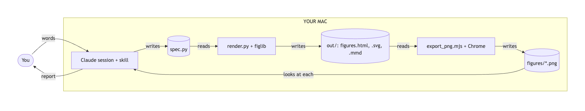
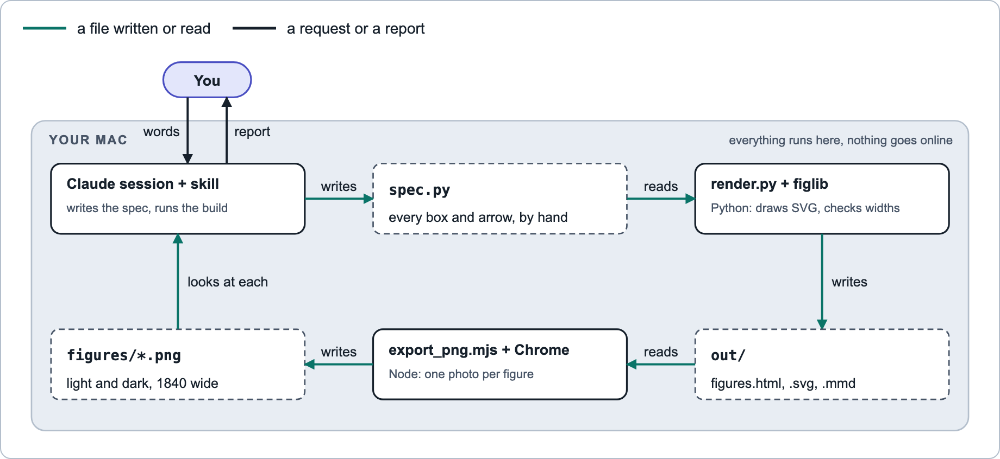

# dans-skills

Claude Code skills by Dan Tanzer.

## What is in it

| Skill | What it does |
|---|---|
| `readable-diagrams` | Draws data flow and sequence pictures as hand-laid-out SVG. Exports a light and a dark PNG for each. Keeps Mermaid text under each picture as a text fallback. |

Before and after, for the same data flow. Click a picture for the step-by-step walkthrough.

<table>
  <tr>
    <th>Before: Mermaid's own layout</th>
    <th>After: <code>readable-diagrams</code></th>
  </tr>
  <tr>
    <td>
      <a href="skills/readable-diagrams/HOW-IT-WORKS.md#from-this-mermaids-own-drawings">
        <picture>
          <source media="(prefers-color-scheme: dark)" srcset="skills/readable-diagrams/sample/figures/data-flow-mermaid-dark.png">
          
        </picture>
      </a>
    </td>
    <td>
      <a href="skills/readable-diagrams/HOW-IT-WORKS.md#to-this-the-skills-drawings">
        <picture>
          <source media="(prefers-color-scheme: dark)" srcset="skills/readable-diagrams/sample/figures/data-flow-dark.png">
          
        </picture>
      </a>
    </td>
  </tr>
</table>

## Install

```bash
claude plugin install dans-skills --marketplace DanTanzer/dans-skills
```

Then type `/reload-plugins` in the session. The one-step line needs Claude Code 2.1.275 or later. On an older version, run `claude plugin marketplace add DanTanzer/dans-skills`, then `claude plugin install dans-skills@dans-skills`.

## Before the first picture

The PNG export needs Node and Google Chrome on the Mac. Before the first export, Claude runs the skill's `scripts/doctor.sh` to check the Mac, then `scripts/doctor.sh --install` once, in the skill's own folder, to install `puppeteer`.

[`HOW-IT-WORKS.md`](skills/readable-diagrams/HOW-IT-WORKS.md) walks through one build, step by step, with a small sample.

## Contributing

How the repo is laid out, and how to check a change: [`CONTRIBUTING.md`](CONTRIBUTING.md).

## License

MIT. See [`LICENSE`](LICENSE).
