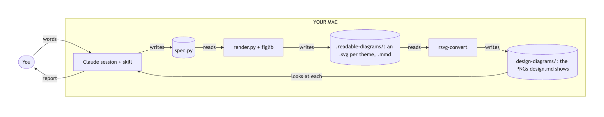
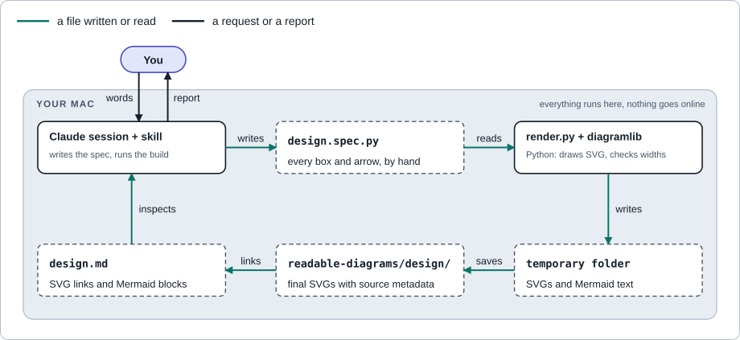
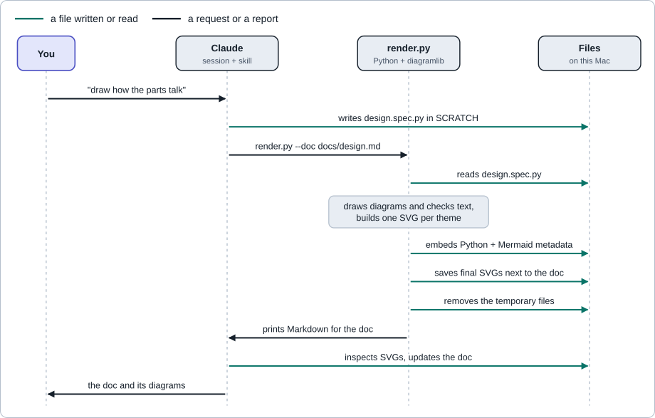

# dans-skills

Claude Code skills by Dan Tanzer.

## What is in it

| Skill | What it does |
|---|---|
| `readable-diagrams` | Creates hand-laid-out SVG diagrams and stores the Python spec and Mermaid source in each SVG. Includes a one-time tool for migrating older PNG diagrams. |

Compare two versions of the same data flow. Select an image to open the workflow guide.

<table>
  <tr>
    <th>Mermaid</th>
    <th>readable-diagrams</th>
  </tr>
  <tr>
    <td>
      <a href="skills/readable-diagrams/HOW-IT-WORKS.md#the-workflow-at-a-glance">
        <picture>
          <source media="(prefers-color-scheme: dark)" srcset="skills/readable-diagrams/sample/diagrams/data-flow-mermaid-dark.png">
          
        </picture>
      </a>
    </td>
    <td>
      <a href="skills/readable-diagrams/HOW-IT-WORKS.md#the-workflow-at-a-glance">
        <picture>
          <source media="(prefers-color-scheme: dark)" srcset="skills/readable-diagrams/sample/diagrams/data-flow-dark.svg">
          
        </picture>
      </a>
    </td>
  </tr>
</table>

## Install

```bash
claude plugin install dans-skills --marketplace DanTanzer/dans-skills
```

Then run `/reload-plugins` in your session. The one-step install requires Claude Code 2.1.275 or later. For an older version, run `claude plugin marketplace add DanTanzer/dans-skills`, then `claude plugin install dans-skills@dans-skills`.

### With the skills CLI

You can also install the skill with Vercel's [`skills`](https://github.com/vercel-labs/skills) CLI:

For all your projects:

```bash
npx skills add DanTanzer/dans-skills --skill readable-diagrams -a claude-code -g
```

For the repo you're in:

```bash
npx skills add DanTanzer/dans-skills --skill readable-diagrams -a claude-code
```

## Before you render

The SVG workflow uses Python's standard library. It does not need `rsvg-convert` or other rendering tools.

See [`HOW-IT-WORKS.md`](skills/readable-diagrams/HOW-IT-WORKS.md) for the workflow and PNG migration steps.

## Try it

Ask Claude to create a diagram. By default, it creates a light SVG; you can request a dark version or both. Files go in a `readable-diagrams/` folder beside the document, with a subfolder for each document. For example, diagrams for `design.md` go in `readable-diagrams/design/`. Each SVG includes the Python spec and Mermaid source in its metadata.

To migrate older PNG diagrams, run `python3 -I scripts/migrate_png_to_svg.py PATH/TO/FOLDER` from the installed skill directory. The tool recovers embedded sources and creates an SVG if one is missing. It leaves the PNG in place and only supports PNGs with readable-diagrams metadata. Review the embedded Python before migrating; rendering runs that code. This tool does not sync later edits to an SVG back to its source.

To draw the sample that comes with the skill:

```text
Draw the readable-diagrams sample.
```

To add a picture to a doc:

```text
Use readable-diagrams to add a picture of how the parts talk to @docs/design.md.
```

To redraw a Mermaid diagram by hand:

```text
Use readable-diagrams to redraw the Mermaid diagram in @README.md.
```

## How a picture gets made

Claude writes a small Python spec. The skill draws the spec as an SVG and embeds both the Python and Mermaid sources in the SVG metadata. The SVG is saved beside the document, and the Mermaid text appears below it. To change a diagram, update the Python spec and Mermaid text, then rerender. Editing the SVG alone does not update either source.

The data flow of one build, drawn by the skill:

<picture>
  <source media="(prefers-color-scheme: dark)" srcset="skills/readable-diagrams/sample/diagrams/data-flow-dark.svg">
  
</picture>

The same build, in order:

<picture>
  <source media="(prefers-color-scheme: dark)" srcset="skills/readable-diagrams/sample/diagrams/build-sequence-dark.svg">
  
</picture>

[`HOW-IT-WORKS.md`](skills/readable-diagrams/HOW-IT-WORKS.md) has the full steps and commands.

## Contributing

To update a skill or add one, see [`CONTRIBUTING.md`](CONTRIBUTING.md).

## License

MIT. See [`LICENSE`](LICENSE).
