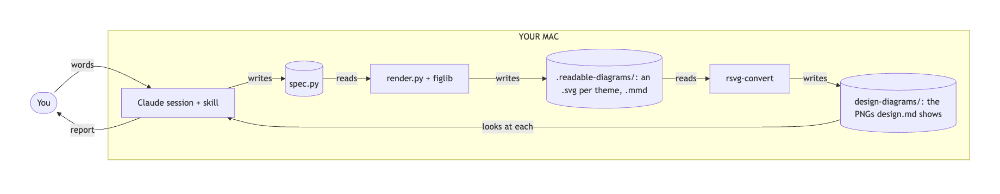
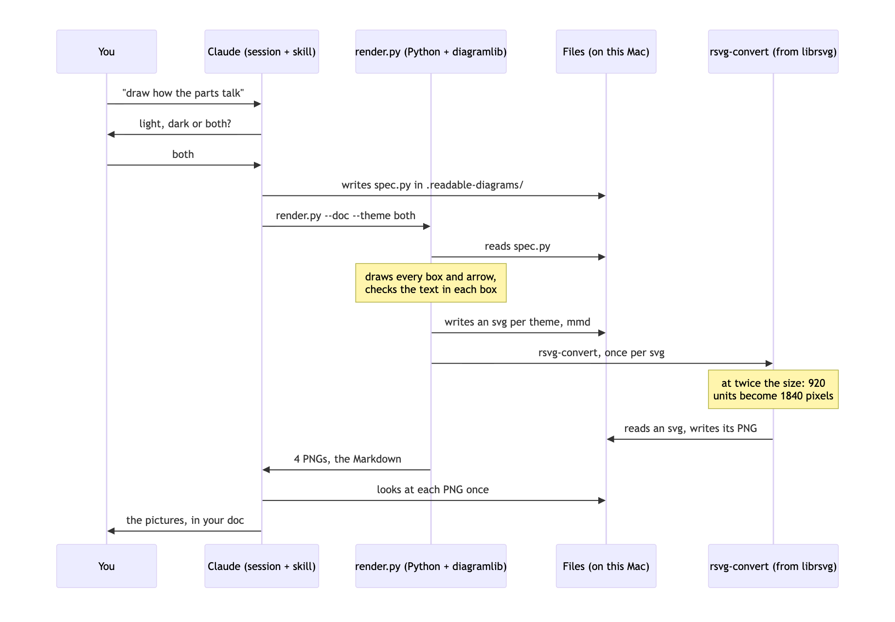
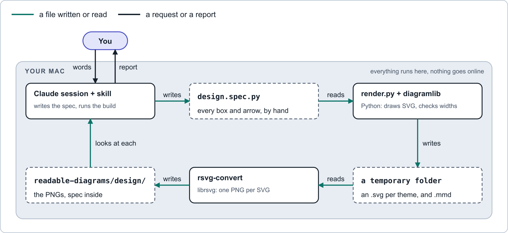
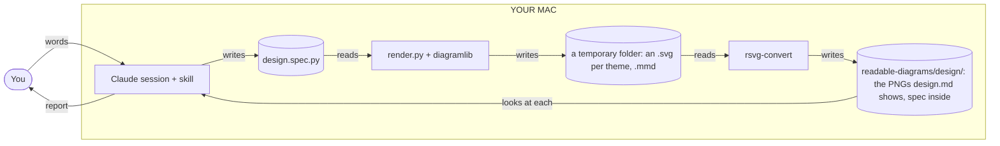
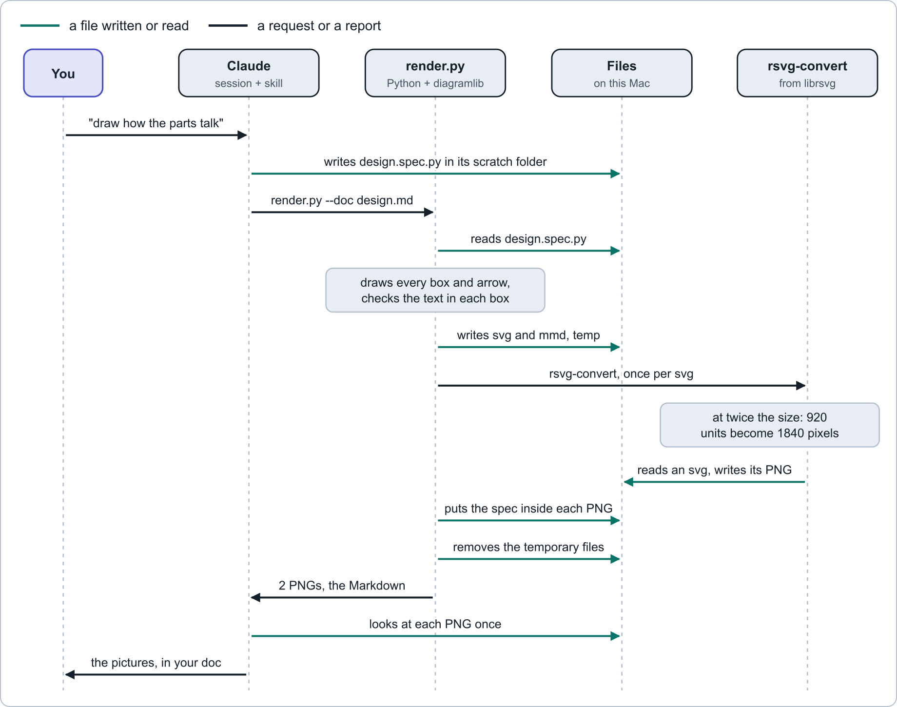
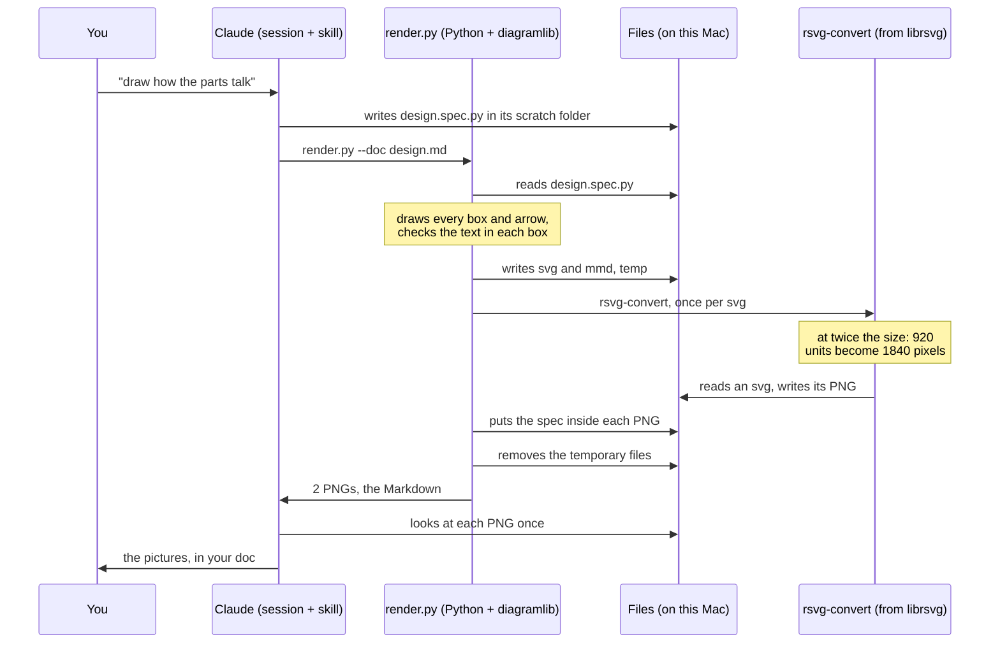

# How readable-diagrams works

`readable-diagrams` is a skill for Claude Code, Anthropic's coding tool. A skill is a folder of instructions and scripts that Claude follows. This skill turns a short Python file into diagrams: PNG (Portable Network Graphics) pictures, light, dark or both.

Mermaid is a common text format for diagrams. GitHub draws Mermaid text by itself. You go from Mermaid's two drawings below to the skill's drawings of the same two diagrams: a data flow and a sequence. All four pictures show the same build.

## From this: Mermaid's own drawings

The data flow:

<picture>
  <source media="(prefers-color-scheme: dark)" srcset="sample/diagrams/data-flow-mermaid-dark.png">
  
</picture>

Mermaid places every box by itself. Fitted to the page, the chart becomes one long strip with small text. The labels sit on grey patches on top of the lines. The last arrow loops back under the whole chart. There is no legend.

The sequence:

<picture>
  <source media="(prefers-color-scheme: dark)" srcset="sample/diagrams/build-sequence-mermaid-dark.png">
  
</picture>

Mermaid draws a sequence fairly well. Still, every arrow looks the same, so a file written and a request cannot be told apart. The vertical lines run through three of the labels. You are a box, like the programs. The long names fill their boxes edge to edge, and every name repeats at the bottom. There is no legend.

These pictures were made for this page, with Mermaid `11.4.1` in Chrome, at the same width as the skill's pictures. Nothing in this repo remakes them. The skill itself never runs Mermaid.

## To this: the skill's drawings

The data flow:

<picture>
  <source media="(prefers-color-scheme: dark)" srcset="sample/diagrams/data-flow-dark.png">
  
</picture>

<details>
<summary>The same diagram as Mermaid text (open it to edit)</summary>



</details>

The sequence, which is the whole build in order:

<picture>
  <source media="(prefers-color-scheme: dark)" srcset="sample/diagrams/build-sequence-dark.png">
  
</picture>

<details>
<summary>The same diagram as Mermaid text (open it to edit)</summary>



</details>

Every box, arrow and label sits where Claude put it. The legend inside each picture explains its arrows. Files are dashed boxes. Programs are solid boxes. A person is a pill. In the sequence, an arrow's colour says what moves: a file, or a request or report.

## TL;DR: the short version

1. Claude writes a small Python file, the spec, in its scratch folder, outside your project. In a data flow, the spec places every box, arrow and label by hand. In a sequence, the spec lists the messages in order, and the code places them.
2. `render.py` turns the spec into SVG (Scalable Vector Graphics), using `diagramlib.py`. It checks that the text in boxes and sequences fits, and that each box is tall enough for its text. It writes one SVG per diagram and theme, each complete on its own, in a temporary folder.
3. `rsvg-convert` draws each SVG as a PNG, at twice its size, into a subfolder next to the doc: `readable-diagrams/design/` for `design.md`. The picture is light (white) unless you ask for dark or both. `render.py` then puts the spec inside each PNG, so the picture carries its own source, and removes the temporary folder.
4. Claude looks at every picture. Then Claude pastes the Markdown that `render.py` prints into the doc, with the Mermaid text folded underneath.

In your repo, only the doc and its `readable-diagrams/<doc name>/` folder change. No build file and no copy of the spec stays on the laptop. A build never goes online. Only the one-time install does: `brew install librsvg` downloads `rsvg-convert` from Homebrew, the package manager for the Mac.

## Step by step, with the sample

The sample in this folder builds the skill's two pictures above: the data flow and the sequence.

| Path | What it is |
|---|---|
| `sample/spec.py` | The input: two diagrams, in 91 lines of Python |
| `sample/diagrams/` | The pictures, copied from the sample's build folder, plus Mermaid's drawings of both, for comparison |

### Step 1: Claude writes the spec

A spec is a Python file. diagramlib reads two names from it. Only `DIAGRAMS` is required.

| Name | What it holds |
|---|---|
| `DIAGRAMS` | One entry per picture |
| `LEGEND` | New words for any of the four arrow meanings. The others keep their defaults. |

Each entry in `DIAGRAMS` has a `stem`, which becomes the file name. It has an `alt`: one sentence for screen readers, with no double quotes. It also has one of two drawing kinds:

- **A data flow** is a Python function that places parts on a `Canvas`. The canvas is 1000 units wide. The top edge is y = 0, and larger y values sit lower. Claude chooses every x and every y.
- **A sequence** is a table of rows. Claude only lists the rows. diagramlib places them.

The start of the sample's data flow, then three of its parts:

```python
ROW_A, ROW_B, H = 120, 290, 410
COLS = (40, 370, 700)  # three columns, 260 wide, 70 apart: room for one arrow and one short label
W = 260
c = Canvas("flow", 1000, H, DATA_FLOW_ALT)

c.box(COLS[0], ROW_A, W, 72, "Claude session + skill", [("writes the spec, runs the build", "ts")])
c.store(COLS[1], ROW_A, W, 72, "spec.py", "every box and arrow, by hand")
c.arrow(COLS[0] + W, ROW_A + 36, COLS[1], ROW_A + 36, "file").label(335, ROW_A + 28, "writes", "middle")
```

The first four numbers of `box` and `store` are x, y, width and height. A `box` is a program. A `store` is a file. The `"ts"` makes a line small and grey.

`box_height(title, lines)` returns the exact height a box needs for its text. The last line then sits 16 units above the bottom edge, about as far as the title's capitals sit below the top edge. A shorter box stops the build. The sample's boxes are 72 tall, the same as the files beside them. On their own, they would need 66.

`arrow` takes a start point, an end point and a kind. Claude places the boxes so the two points share an x or a y, and the arrow runs straight across or straight down. When two boxes cannot line up, `elbow` takes the same arguments and draws the link with right-angle bends. `arrow` refuses a diagonal unless the spec says it is meant. `.label` writes a word at its own x and y. `"middle"` centres that word on its x. The sample also uses a `zone`, the tinted panel for a machine, here YOUR MAC. It also uses a `pill`, which is a person.

An arrow has one of four kinds:

| Kind | Looks | Means |
|---|---|---|
| `file` | Teal, solid | A file is written or read |
| `ring` | Amber, dashed | A nudge that carries no content |
| `say` | Ink, solid | A person's words, or Claude's report |
| `loc` | Grey, dashed, thin | Data that stays on one machine |

In a data flow, the layout is the hard part. The layout is Claude's job. diagramlib checks and draws a data flow, but places nothing in it by itself.

A sequence is different: diagramlib places everything. Two rows of the sample's sequence:

```python
("msg", "C", "R", "render.py --doc design.md", "say"),
("note", "R", ["draws every box and arrow,", "checks the text in each box"]),
```

A lifeline is the dashed line that runs down from each name. diagramlib spaces the lifelines evenly:

| Sequence measure | Value |
|---|---|
| First lifeline | x = 60 |
| Last lifeline | x = 910 |
| One message row | 44 units tall |
| One note | 66 units tall |

A message label must fit between its two lifelines.

### Step 2: run render.py

The Mac needs two things:

1. Python 3
2. `rsvg-convert`, from librsvg, a library that draws SVG. Homebrew installs it once per Mac: `brew install librsvg`

The sample has no doc, so it builds with `--out`, which keeps every file in one folder. `SCRATCH` stands for a temporary folder:

```bash
cd skills/readable-diagrams
bash scripts/doctor.sh                                                       # checks the Mac, changes nothing
python3 -I scripts/render.py sample/spec.py --out SCRATCH/sample --theme both
```

The output of the last command, with the folder you gave:

```text
built 2 diagram(s) in SCRATCH/sample: data-flow, build-sequence
4 PNG(s), light and dark, in SCRATCH/sample. Look at each one once before you ship it.
```

For a doc, Claude runs one command. `SKILL` stands for the skill's folder, and `SCRATCH` for the session's scratch folder, where the spec lives while Claude works, named after the doc:

```bash
python3 -I SKILL/scripts/render.py SCRATCH/design.spec.py --doc docs/design.md
```

With `--doc`, the PNGs go next to the doc, in `docs/readable-diagrams/design/`: a `readable-diagrams` folder with one subfolder for each doc, so two docs in one folder keep their pictures apart and each doc's pictures stay together. The SVG and Mermaid files are built in a temporary folder that `render.py` removes when it ends, and the spec goes inside each PNG, so no copy of the spec stays on the laptop. To change a picture later, Claude takes the spec out of one of its PNGs with `embed_spec.py extract` and builds again.

`--theme` is light, the white picture, unless it says `dark` or `both`. Claude does not ask which one to make. `--keep-svg` is off unless given. With it, each SVG stays beside its PNG in `docs/readable-diagrams/design/`, under the same name, and a build without it removes the SVGs an earlier build kept, so a kept SVG never goes stale.

`doctor.sh` checks Python, `rsvg-convert` and the two fonts. It prints one line per check, and a → line under anything missing. For `rsvg-convert`, that line is `brew install librsvg`. The doctor changes nothing.

Add `--no-png` to stop after the SVG files. `SKILL.md` has Claude build that way first. Text that does not fit then shows up before any PNG is drawn.

Steps 3 to 5, and the Markdown for step 7, all come from this one `render.py` command. `render.py` does four things:

1. It loads the spec file as a Python module, without writing a `__pycache__` folder next to it.
2. It calls `diagramlib.build`, which writes an SVG file per diagram and theme, and the Mermaid files, in a temporary folder (steps 3 and 4).
3. It runs `rsvg-convert` once for each SVG file, and puts the spec inside each PNG (step 5). If `rsvg-convert` fails on a file, the build stops and prints `rsvg-convert`'s own error.
4. With `--doc`, it removes the doc's PNGs in a theme the doc no longer shows, then prints the Markdown for each diagram (step 7). When it ends, it removes the temporary folder.

When `rsvg-convert` is not installed, `render.py` catches the error and runs `doctor.sh`. It prints the doctor's report: the same lines the doctor prints on its own. A failed export leaves no empty folder next to the doc.

The `-I` flag runs Python in isolated mode. Isolated mode ignores your own Python settings, such as `PYTHONPATH`. So your settings cannot change which code runs. Isolated mode also leaves the script's folder off the import path. So `render.py` adds its own folder to the path. Without that step, `import diagramlib` would fail.

### Step 3: diagramlib draws the SVG, checks the text and writes the Mermaid text

SVG is a picture written as text: shapes and words, each with a position. Each canvas call adds a few SVG elements. So the `store` call from step 1 becomes this SVG (line breaks added):

```xml
<rect class="store" x="370" y="120" width="260" height="72" rx="8"/>
<text class="tm tb" x="386" y="152" text-anchor="start">spec.py</text>
<text class="t" x="386" y="180" text-anchor="start">every box and arrow, by hand</text>
```

The diagram holds no colours yet. The class names get their colours and fonts in step 4. `store` is the dashed file box. `tm` sets the mono font, Menlo. `tb` sets bold.

Before diagramlib writes text into a box, a store, a pill, a zone title or a sequence, it checks that the text fits. The estimate is simple: the number of characters, times a width per character. For Arial the width is an average. For Menlo it is exact.

| Text class | Used for | Size, in units | Width per character, in units |
|---|---|---|---|
| `t` | Plain lines and sequence labels | 14 | 6.2, average |
| `tb` | Box titles | 15, bold | 7.0, average |
| `ts` | Small grey lines | 12.5 | 5.6, average |
| `tm tb` | File and folder names in a store | 15, bold Menlo | 9.03, exact |

These numbers are canvas units, though diagramlib's messages say px. In the PNG, one canvas unit is about 1.8 pixels.

If the estimate is wider than the room, the build stops and names the text. This is a real refusal, from a box line that is too long:

```text
diagram error: box line 'Python: draws every SVG diagram and checks every label width' needs 336px but has 228px: shorten it or widen the box
```

The fix is fewer words or a wider box, never a smaller font.

Two kinds of text skip the check. The first is a word placed with `label()`, such as every arrow word in the data flow. The second is a zone subtitle. diagramlib cannot know how much room a free word has. The look in step 6 is their only check.

diagramlib also writes the sequence as Mermaid text, in `build-sequence.mmd`, in the build folder. That text is the closed block under the sequence picture above.

A data flow gets a Mermaid file only when the spec gives one. diagramlib cannot write one itself. A canvas holds only shapes at positions, so it does not know which box an arrow joins. The sample gives its Mermaid text by hand, under the `"mermaid"` key.

### Step 4: each diagram becomes an SVG file per theme

diagramlib puts each diagram on a card, 920 units wide. The card holds the arrow legend first, cut down to the kinds this diagram uses, then the diagram. Both sample diagrams use only two arrow kinds, so each legend shows two entries.

Each SVG file carries its own style sheet (CSS, Cascading Style Sheets). The style sheet gives each class a colour and a font.

Every colour is a token: a named colour with a light value and a dark value.

| Token | Used for | Light | Dark |
|---|---|---|---|
| `--surface` | The card behind the diagram | `#FFFFFF` | `#141C26` |
| `--ink` | Text and `say` arrows | `#16202B` | `#E7EDF3` |
| `--file` | `file` arrows | `#0A7468` | `#3DD6C2` |
| `--ring` | `ring` arrows | `#B04F08` | `#F4B14F` |

The light file, `data-flow.svg`, holds the light values. The dark file, `data-flow-dark.svg`, holds the dark values. So each file is complete on its own: open either one in a browser, and it looks like its PNG. A doc that shows one theme gets only that theme's file.

Words use Arial. File names use Menlo. Both fonts come with every Mac, so nothing is downloaded.

### Step 5: rsvg-convert draws each PNG

`rsvg-convert` comes with librsvg. It reads one SVG file and writes one PNG file, with no browser and no window.

`render.py` runs it once for each SVG file:

```bash
rsvg-convert --zoom 2 --output SCRATCH/sample/data-flow.png SCRATCH/sample/data-flow.svg
```

With `--doc`, the `--output` path is in the doc's `readable-diagrams/<doc name>/` folder instead, such as `docs/readable-diagrams/design/data-flow.png`, and the SVG is in the temporary folder.

The card is 920 units wide, so at `--zoom 2` the PNG is 1840 pixels wide. Outside the card's rounded corners, the PNG is transparent.

The light file becomes `<stem>.png`, and the dark file becomes `<stem>-dark.png`. The sample's pictures:

| Picture | Size in pixels |
|---|---|
| `data-flow.png` | 1840 × 846 |
| `build-sequence.png` | 1840 × 1450 |

Then `render.py` puts the spec inside each PNG. The spec's text goes in as a PNG text chunk named `readable-diagrams-spec`, just before the end of the file. The pixels do not change, and the picture draws the same. The file grows by the size of the spec, a few kilobytes.

`embed_spec.py` reads the PNG before it writes. A PNG that already holds exactly this spec is not written at all. One that holds a different spec gets the new one in its place. A PNG never holds two. To get a spec back, which is how Claude starts a change to pictures that exist:

```bash
python3 -I scripts/embed_spec.py extract docs/readable-diagrams/design/data-flow.png SCRATCH
```

That writes `SCRATCH/data-flow.spec.py`, named after the picture, so pictures that share a folder never share a spec file. `extract` reads before it writes too: a file that already holds the spec is left alone, and a file that holds something else stops the extract, so edits in it are never lost.

### Step 6: Claude looks at every PNG once

`SKILL.md` tells Claude to open each PNG with its Read tool. The Read tool shows Claude the image itself. Claude looks for four faults:

1. Two labels touching
2. A label past an edge
3. An arrow crossing text
4. A file box whose last line sits on its bottom edge

If Claude finds one, Claude changes the spec and builds again. The width check catches most overflows in boxes and sequences. This look catches the rest, including every free label. A program box never has the fourth fault: the build refuses one shorter than its text needs.

Claude also looks at each elbow. When shifting one box left or right would let the arrow run straight, Claude shifts the box: a straight line reads faster than a bent one.

### Step 7: the picture goes into a document

With `--doc`, the PNGs are already next to the document, in its `readable-diagrams/<doc name>/` folder. `render.py` prints the Markdown for each diagram, and Claude pastes it into the document where the picture goes.

With both themes, the Markdown is a `<picture>` element. It shows the dark PNG in dark mode, and the light PNG otherwise. With one theme, it is a plain Markdown image of that theme's PNG. Under either one, a closed `<details>` element holds the Mermaid text, and GitHub draws that text as a plain Mermaid chart.

Anyone can copy or edit the Mermaid text. Editing the text does not change the PNG. To change the picture, change the spec and build again. To change the theme, build again with the new `--theme`: `render.py` removes the PNGs the doc no longer shows, and prints the new Markdown.

The two skill pictures on this page are such blocks. Their PNGs sit in `sample/diagrams/`, copied from the sample's build folder, because two pages show them: this one and the README.

## What each file does

| File | Kind | Job |
|---|---|---|
| `SKILL.md` | Instructions for Claude | When to use the skill, the steps, and the style rules |
| `HOW-IT-WORKS.md` | Markdown | This page |
| `.gitignore` | git settings | Keeps Python caches out of git, so a copied skill folder stays clean |
| `scripts/diagramlib.py` | Python, standard library only | The canvas, sequences, text checks, box heights, style sheet, legend card, Mermaid text and picture block |
| `scripts/render.py` | Python | One command: a build writes the SVGs and the Mermaid text in a temporary folder, draws each PNG with `rsvg-convert` into `readable-diagrams/<doc name>/`, puts the spec inside it, prints the Markdown and removes the temporary folder |
| `scripts/embed_spec.py` | Python, standard library only | Puts a spec inside a PNG as a `tEXt` chunk and gets it back. `embed` reads the PNG before it writes, and a PNG never holds two specs. `extract` prints the spec byte for byte |
| `scripts/doctor.sh` | bash | Checks the Mac: Python, `rsvg-convert` and the fonts |
| `scripts/example_spec.py` | Python | A bigger example: one data flow and two sequences |
| `scripts/tests/test_diagramlib.py` | Python | 53 tests: the example and the sample build, each SVG is complete on its own in both themes, the checks refuse what they should, `box_height` is the least height a box accepts, an elbow bends where it should and a diagonal is refused, a zone subtitle stays clear of its title, the doctor names `rsvg-convert`, a theme change removes the other theme's pictures, a doc gets its pictures in `readable-diagrams/<doc name>/`, light by default, with no build file kept unless `--keep-svg` is given, each PNG carries its spec once, and the Markdown fits one theme or both |
| `scripts/tests/test_embed_spec.py` | Python | 34 tests: the spec comes back byte for byte, every other chunk stays untouched, a second embed replaces the first, a PNG that already holds the spec is not written, a PNG that holds two specs ends with one, a real PNG from another encoder takes the spec, the four sample pictures carry the current sample spec, and extract names the file after the picture and never overwrites a different one, and a file that is not a PNG gets a plain message |
| `scripts/tests/pngs.py` | Python | A PNG small enough to build by hand, for the tests that need a real one |
| `references/layout.md` | Markdown | Coordinates and sizes for laying out a new diagram |
| `sample/` | Python and PNG | The spec and pictures this page walks through |

## Known limits

- **The width check is an average, not a ceiling.** A long label at its limit can run up to about a fifth wider than its estimate. Step 6 catches it.
- **Free labels are not checked.** Words placed with `label()`, and zone subtitles, rely on step 6.
- **The spec travels in plain text.** Each PNG carries its spec as readable text, so anyone who gets the file can read it. A service that rebuilds images, such as some chat apps and mail gateways, drops it. No other copy of the spec is kept, so a PNG that has lost its spec cannot be rebuilt: the committed PNG in the repo is the copy to rely on.
- **The defaults are for a Mac.** Arial and Menlo come with macOS. On another system, `rsvg-convert` uses the nearest fonts it has, and the width checks are less exact. The doctor's install line uses Homebrew.
