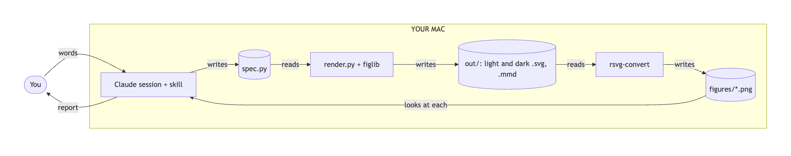
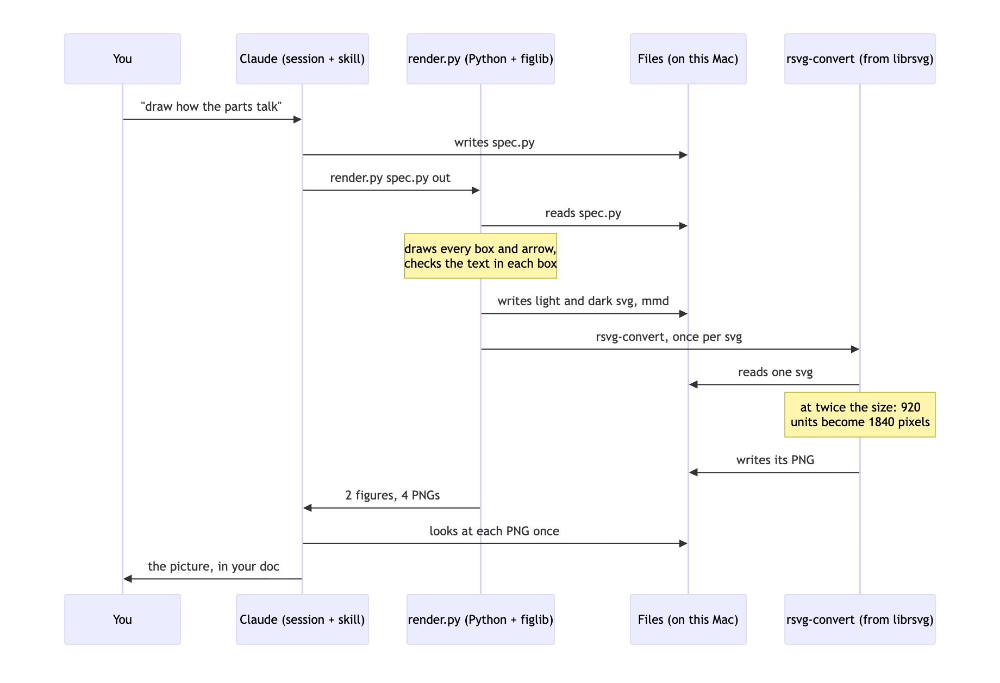
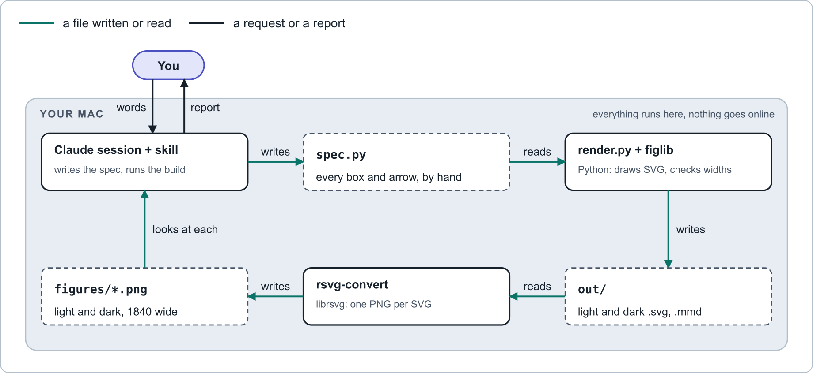
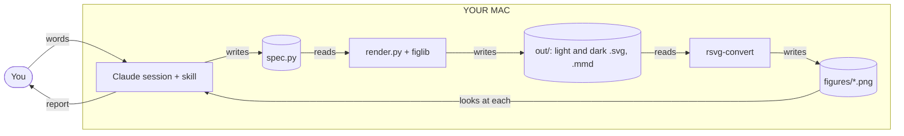
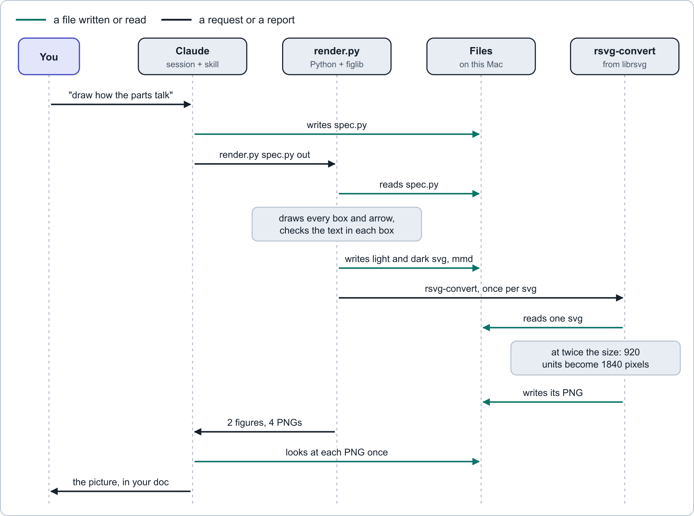
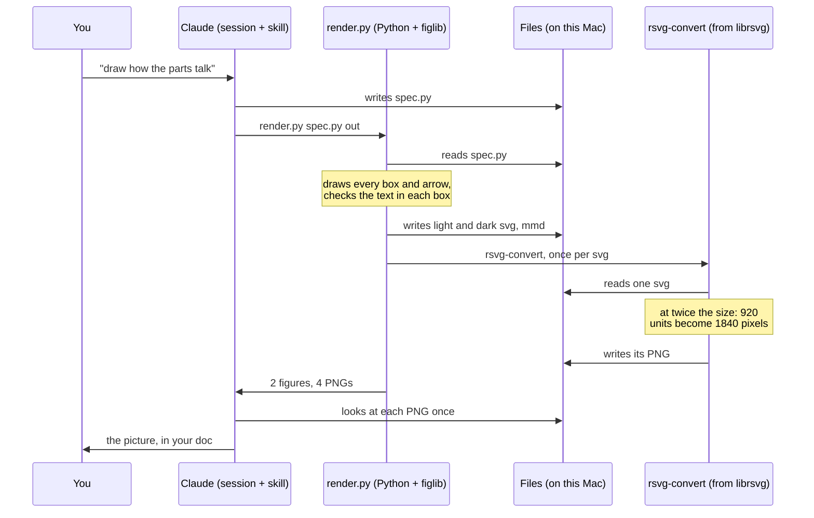

# How readable-diagrams works

`readable-diagrams` is a skill for Claude Code, Anthropic's coding tool. A skill is a folder of instructions and scripts that Claude follows. This skill turns a short Python file into diagrams: PNG (Portable Network Graphics) pictures, one light and one dark.

Mermaid is a common text format for diagrams. GitHub draws Mermaid text by itself. You go from Mermaid's two drawings below to the skill's drawings of the same two diagrams: a data flow and a sequence. All four pictures show the same build.

## From this: Mermaid's own drawings

The data flow:

<picture>
  <source media="(prefers-color-scheme: dark)" srcset="sample/figures/data-flow-mermaid-dark.png">
  
</picture>

Mermaid places every box by itself. Fitted to the page, the chart becomes one long strip with small text. The labels sit on grey patches on top of the lines. The last arrow loops back under the whole chart. There is no legend.

The sequence:

<picture>
  <source media="(prefers-color-scheme: dark)" srcset="sample/figures/build-sequence-mermaid-dark.png">
  
</picture>

Mermaid draws a sequence fairly well. Still, every arrow looks the same, so a file written and a request cannot be told apart. The vertical lines run through three of the labels. You are a box, like the programs. The long names fill their boxes edge to edge, and every name repeats at the bottom. There is no legend.

These pictures were made once for this page, with Mermaid `11.4.1` in Chrome, at the same width as the skill's pictures. Nothing in this repo remakes them. The skill itself never runs Mermaid.

## To this: the skill's drawings

The data flow:

<picture>
  <source media="(prefers-color-scheme: dark)" srcset="sample/figures/data-flow-dark.png">
  
</picture>

<details>
<summary>The same diagram as Mermaid text (open it to edit)</summary>



</details>

The sequence, which is the whole build in order:

<picture>
  <source media="(prefers-color-scheme: dark)" srcset="sample/figures/build-sequence-dark.png">
  
</picture>

<details>
<summary>The same diagram as Mermaid text (open it to edit)</summary>



</details>

Every box, arrow and label sits where Claude put it. The legend inside each picture explains its arrows. Files are dashed boxes. Programs are solid boxes. A person is a pill. In the sequence, an arrow's colour says what moves: a file, or a request or report.

## TL;DR: the short version

1. Claude writes a small Python file, the spec. In a data flow, the spec places every box, arrow and label by hand. In a sequence, the spec lists the messages in order, and the code places them.
2. `render.py` turns the spec into SVG (Scalable Vector Graphics), using `figlib.py`. It checks that the text in boxes and sequences fits, and that each box is tall enough for its text. It writes every figure twice: a light SVG and a dark SVG, each complete on its own.
3. `rsvg-convert` draws each SVG as a PNG, at twice its size.
4. Claude looks at every picture. Then Claude pastes each picture into a document, with the Mermaid text folded underneath.

A build never goes online. Only the one-time install does: `brew install librsvg` downloads `rsvg-convert` from Homebrew, the package manager for the Mac.

## Step by step, with the sample

The sample in this folder builds the skill's two pictures above: the data flow and the sequence.

| Path | What it is |
|---|---|
| `sample/spec.py` | The input: two figures, in 86 lines of Python |
| `sample/figures/` | The pictures, copied from the build's `out/figures/`, plus Mermaid's drawings of both, for comparison |

### Step 1: Claude writes the spec

A spec is a Python file. figlib reads three names from it. Only `FIGURES` is required.

| Name | What it holds |
|---|---|
| `FIGURES` | One entry per picture |
| `LEGEND` | New words for any of the four arrow meanings. The others keep their defaults. |

Each entry in `FIGURES` has a `stem`, which becomes the file name. It has an `alt`: one sentence for screen readers, with no double quotes. It also has one of two drawing kinds:

- **A data flow** is a Python function that places parts on a `Canvas`. The canvas is 1000 units wide. The top edge is y = 0, and larger y values sit lower. Claude chooses every x and every y.
- **A sequence** is a table of rows. Claude only lists the rows. figlib places them.

The start of the sample's data flow, then three of its parts:

```python
ROW_A, ROW_B, H = 120, 290, 410
COLS = (40, 370, 700)  # three columns, 260 wide, 70 apart: room for one arrow and one short label
W = 260
c = Canvas("flow", 1000, H, DATA_FLOW_ALT)

c.box(COLS[0], ROW_A, W, 72, "Claude session + skill", [("writes the spec, runs the build", "ts")])
c.store(COLS[1], ROW_A, W, 72, "spec.py", "every box and arrow, by hand")
c.arrow(COLS[0] + W, ROW_A + 36, COLS[1], ROW_A + 36, "file").label(335, ROW_A + 28, "writes", "middle")
```

The first four numbers of `box` and `store` are x, y, width and height. A `box` is a program. A `store` is a file. The `"ts"` makes a line small and grey.

`box_height(title, lines)` returns the exact height a box needs for its text. The last line then sits 16 units above the bottom edge, about as far as the title's capitals sit below the top edge. A shorter box stops the build. The sample's boxes are 72 tall, the same as the files beside them. On their own, they would need 66.

`arrow` takes a start point, an end point and a kind. `.label` writes a word at its own x and y. `"middle"` centres that word on its x. The sample also uses a `zone`, the tinted panel for a machine, here YOUR MAC. It also uses a `pill`, which is a person.

An arrow has one of four kinds:

| Kind | Looks | Means |
|---|---|---|
| `file` | Teal, solid | A file is written or read |
| `ring` | Amber, dashed | A nudge that carries no content |
| `say` | Ink, solid | A person's words, or Claude's report |
| `loc` | Grey, dashed, thin | Data that stays on one machine |

In a data flow, the layout is the hard part. The layout is Claude's job. figlib checks and draws a data flow, but places nothing in it by itself.

A sequence is different: figlib places everything. Two rows of the sample's sequence:

```python
("msg", "C", "R", "render.py spec.py out", "say"),
("note", "R", ["draws every box and arrow,", "checks the text in each box"]),
```

A lifeline is the dashed line that runs down from each name. figlib spaces the lifelines evenly:

| Sequence measure | Value |
|---|---|
| First lifeline | x = 60 |
| Last lifeline | x = 910 |
| One message row | 44 units tall |
| One note | 66 units tall |

A message label must fit between its two lifelines.

### Step 2: run render.py

The Mac needs two things:

1. Python 3
2. `rsvg-convert`, from librsvg, a library that draws SVG. Homebrew installs it once per Mac: `brew install librsvg`

```bash
cd skills/readable-diagrams/scripts
bash doctor.sh                                 # checks the Mac, changes nothing
python3 -I render.py ../sample/spec.py out
```

The real output of the last command:

```text
built 2 figure(s) in out: data-flow, build-sequence
4 PNG(s), light and dark, in out/figures. Look at each one once before you ship it.
```

`doctor.sh` checks Python, `rsvg-convert` and the two fonts. It prints one line per check, and a → line under anything missing. For `rsvg-convert`, that line is `brew install librsvg`. The doctor changes nothing.

Add `--no-png` to stop after the SVG files. `SKILL.md` has Claude build that way first. Text that does not fit then shows up before any PNG is drawn.

Steps 3 to 5 all happen inside this one `render.py` command. `render.py` does three things:

1. It loads the spec file as a Python module.
2. It calls `figlib.build`, which writes two SVG files per figure, light and dark, and the Mermaid files (steps 3 and 4).
3. It runs `rsvg-convert` once for each SVG file (step 5). If `rsvg-convert` fails on a file, the build stops and prints `rsvg-convert`'s own error.

When `rsvg-convert` is not installed, `render.py` catches the error and runs `doctor.sh`. It prints the doctor's report: the same lines the doctor prints on its own.

The `-I` flag runs Python in isolated mode. Isolated mode ignores your own Python settings, such as `PYTHONPATH`. So your settings cannot change which code runs. Isolated mode also leaves the script's folder off the import path. So `render.py` adds its own folder to the path. Without that step, `import figlib` would fail.

### Step 3: figlib draws the SVG, checks the text and writes the Mermaid text

SVG is a picture written as text: shapes and words, each with a position. Each canvas call adds a few SVG elements. So the `store` call from step 1 becomes this SVG (line breaks added):

```xml
<rect class="store" x="370" y="120" width="260" height="72" rx="8"/>
<text class="tm tb" x="386" y="152" text-anchor="start">spec.py</text>
<text class="t" x="386" y="180" text-anchor="start">every box and arrow, by hand</text>
```

The figure holds no colours yet. The class names get their colours and fonts in step 4. `store` is the dashed file box. `tm` sets the mono font, Menlo. `tb` sets bold.

Before figlib writes text into a box, a store, a pill, a zone title or a sequence, it checks that the text fits. The estimate is simple: the number of characters, times a width per character. For Arial the width is an average. For Menlo it is exact.

| Text class | Used for | Size, in units | Width per character, in units |
|---|---|---|---|
| `t` | Plain lines and sequence labels | 14 | 6.2, average |
| `tb` | Box titles | 15, bold | 7.0, average |
| `ts` | Small grey lines | 12.5 | 5.6, average |
| `tm tb` | File and folder names in a store | 15, bold Menlo | 9.03, exact |

These numbers are canvas units, though figlib's messages say px. In the PNG, one canvas unit is about 1.8 pixels.

If the estimate is wider than the room, the build stops and names the text. This is a real refusal, from a box line that is too long:

```text
figure error: box line 'Python: draws every SVG figure and checks every label width' needs 330px but has 228px: shorten it or widen the box
```

The fix is fewer words or a wider box, never a smaller font.

Two kinds of text skip the check. The first is a word placed with `label()`, such as every arrow word in the data flow. The second is a zone subtitle. figlib cannot know how much room a free word has. The look in step 6 is their only check.

figlib also writes the sequence as Mermaid text, in `out/build-sequence.mmd`. That text is the closed block under the sequence picture above.

A data flow gets a Mermaid file only when the spec gives one. figlib cannot write one itself. A canvas holds only shapes at positions, so it does not know which box an arrow joins. The sample gives its Mermaid text by hand, under the `"mermaid"` key.

### Step 4: each figure becomes two SVG files, light and dark

figlib puts each figure on a card, 920 units wide. The card holds the arrow legend first, cut down to the kinds this figure uses, then the figure. Both sample figures use only two arrow kinds, so each legend shows two entries.

Each SVG file carries its own style sheet (CSS, Cascading Style Sheets). The style sheet gives each class a colour and a font.

Every colour is a token: a named colour with a light value and a dark value.

| Token | Used for | Light | Dark |
|---|---|---|---|
| `--surface` | The card behind the figure | `#FFFFFF` | `#141C26` |
| `--ink` | Text and `say` arrows | `#16202B` | `#E7EDF3` |
| `--file` | `file` arrows | `#0A7468` | `#3DD6C2` |
| `--ring` | `ring` arrows | `#B04F08` | `#F4B14F` |

The light file, `out/data-flow.svg`, holds the light values. The dark file, `out/data-flow-dark.svg`, holds the dark values. So each file is complete on its own: open either one in a browser, and it looks like its PNG.

Words use Arial. File names use Menlo. Both fonts come with every Mac, so nothing is downloaded.

### Step 5: rsvg-convert draws each PNG

`rsvg-convert` comes with librsvg. It reads one SVG file and writes one PNG file, with no browser and no window.

`render.py` runs it once for each SVG file:

```bash
rsvg-convert --zoom 2 --output out/figures/data-flow.png out/data-flow.svg
```

The card is 920 units wide, so at `--zoom 2` the PNG is 1840 pixels wide. Outside the card's rounded corners, the PNG is transparent.

The light file becomes `<stem>.png`, and the dark file becomes `<stem>-dark.png`. The sample's pictures:

| Picture | Size in pixels |
|---|---|
| `data-flow.png` | 1840 × 846 |
| `build-sequence.png` | 1840 × 1370 |

### Step 6: Claude looks at every PNG once

`SKILL.md` tells Claude to open each PNG with its Read tool. The Read tool shows Claude the image itself. Claude looks for four faults:

1. Two labels touching
2. A label past an edge
3. An arrow crossing text
4. A file box whose last line sits on its bottom edge

If Claude finds one, Claude changes the spec and builds again. The width check catches most overflows in boxes and sequences. This look catches the rest, including every free label. A program box never has the fourth fault: the build refuses one shorter than its text needs.

### Step 7: the picture goes into a document

The build leaves the PNGs in `out/figures/`. Claude copies them into a `figures/` folder next to the document. For this page, that folder is `sample/figures/`.

Then Claude calls `figlib.picture_block` from Python. Claude pastes the Markdown it returns into the document:

```python
figlib.picture_block("data-flow", alt, mermaid, folder="sample/figures")
```

The block has two parts. A `<picture>` element shows the dark PNG in dark mode. In light mode it shows the light PNG. A closed `<details>` element holds the Mermaid text, and GitHub draws that text as a plain Mermaid chart.

Anyone can copy or edit the Mermaid text. Editing the text does not change the PNG. To change the picture, change the spec and build again.

The two skill pictures on this page are such blocks.

## What each file does

| File | Kind | Job |
|---|---|---|
| `SKILL.md` | Instructions for Claude | When to use the skill, the steps, and the style rules |
| `HOW-IT-WORKS.md` | Markdown | This page |
| `.gitignore` | git settings | Keeps what a build makes out of git, so a copied skill folder stays clean |
| `scripts/figlib.py` | Python, standard library only | The canvas, sequences, text checks, box heights, style sheet, legend card, Mermaid text and picture block |
| `scripts/render.py` | Python | One command: build, then draw each PNG with `rsvg-convert` |
| `scripts/doctor.sh` | bash | Checks the Mac: Python, `rsvg-convert` and the fonts |
| `scripts/example_spec.py` | Python | A bigger example: one data flow and two sequences |
| `scripts/tests/test_figlib.py` | Python | 23 tests: the example and the sample build, each SVG is complete on its own in both themes, the checks refuse what they should, `box_height` is the least height a box accepts, a zone subtitle stays clear of its title, the doctor names `rsvg-convert`, and a relative output folder works |
| `references/layout.md` | Markdown | Coordinates and sizes for laying out a new figure |
| `sample/` | Python and PNG | The spec and pictures this page walks through |

## Known limits

- **The width check is an average, not a ceiling.** A long label at its limit can run up to about a fifth wider than its estimate. Step 6 catches it.
- **Free labels are not checked.** Words placed with `label()`, and zone subtitles, rely on step 6.
- **The defaults are for a Mac.** Arial and Menlo come with macOS. On another system, `rsvg-convert` uses the nearest fonts it has, and the width checks are less exact. The doctor's install line uses Homebrew.
